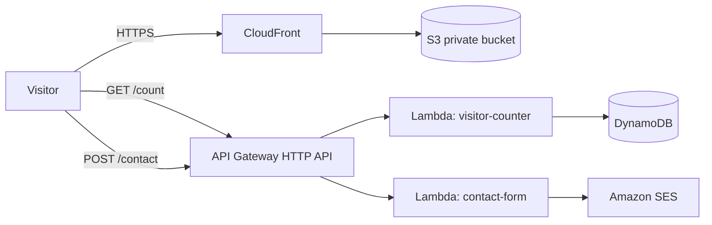

# Serverless Portfolio Website on AWS

A portfolio website with a live visitor counter and a contact form, built entirely on AWS serverless services.

**Live site:** https://d3bcwbsfm94chl.cloudfront.net

## Architecture

## How it works

- **Website:** static HTML in a private S3 bucket, served over HTTPS by CloudFront.
- **Visitor counter:** the page calls `GET /count`. A Python Lambda adds 1 to a DynamoDB item using an atomic update and returns the new count.
- **Contact form:** the page sends `POST /contact`. A Python Lambda validates the input and emails me through Amazon SES.

## Services used

S3, CloudFront, API Gateway (HTTP API), Lambda (Python), DynamoDB (on-demand), SES, IAM, CloudWatch Logs. Region: ap-southeast-2.

## Security decisions

- The S3 bucket blocks all public access. The bucket policy allows reads only from my CloudFront distribution.
- Each Lambda has its own IAM role with one permission:
  - `visitor-counter`: `dynamodb:UpdateItem` on one table
  - `contact-form`: `ses:SendEmail` on one verified identity
- CORS allows only the CloudFront site origin.
- API throttling is set to 5 requests per second (burst 10).
- The contact function validates and length-limits input.
- My email address is stored in a Lambda environment variable, not in the code.

## Cost

Everything is pay-per-use with no always-on servers. Usage stays inside AWS Free Plan credits, and a zero-spend budget alert is set.

## Challenges I solved

- New Lambda functions defaulted to a broad console role, so I replaced them with dedicated least-privilege roles.
- CloudFront returned Access Denied until I set the default root object to `index.html`.
- The browser blocked API calls until I configured CORS for the site origin.

## Limitations and next steps

- SES is in sandbox mode, so it only sends to verified addresses.
- Resources were created manually in the console. Next: define them with AWS SAM or Terraform and add GitHub Actions CI/CD.
- Next: a custom domain.

## Repository layout

- `frontend/`: the website
- `backend/`: Lambda functions
- `iam/`: example IAM policies (placeholders for account ID and email)

## Author

Your Name
